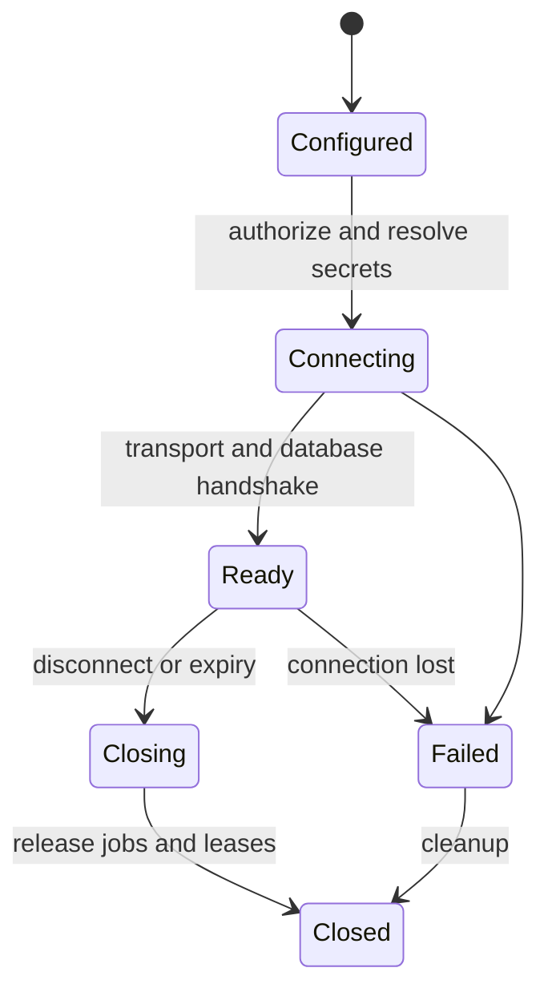

# Connection management

**Status: partially implemented evaluation.** The desktop app's profiles are all live (Direct or SSH MySQL/MariaDB/PostgreSQL, and SQLite files in development builds), read-write by default on the enabled routes ([A15](../development/sql-execution.md)); the browser demo's profiles are mocks. The [M003 runtime](../development/connection-lifecycle.md) has owner-scoped pools, TLS, expiry and shutdown tests; [M004](../development/postgres-sqlite.md) adds PostgreSQL VerifyFull TLS and owner-scoped SQLite file grants. Native live binding and renderer-bootstrap cleanup are implemented. [M005](../development/ssh-credentials.md) adds desktop SSH tunnels (verified enrolled host keys, agent/password/key file) and macOS Keychain secret references; other operating systems and a server vault remain unimplemented. Teleport/SSM remain unimplemented.

## Identity and ownership

Separate non-secret profile metadata (name, engine, group, color, environment) from transport configuration and secret references. A runtime connection handle belongs to one desktop session or authenticated server principal. Database/schema, credentials, endpoint and generation are part of its identity. Never reuse a pool across unrelated principals merely because hosts match.

Lifecycle (implemented for desktop live connections; a future server host would follow the same states):

Start transport before pool creation, enforce timeouts, and unwind in reverse order on failure. Use bounded pools, idle expiry and explicit disconnect. Transactions lease a physical connection; session variables, temporary objects and raw transaction statements can make a connection unsafe to return to the pool. Reset verifiably or discard it. Lost connections invalidate schema generations and active leases.

## Implementation sequence

M003-L accepts the Direct connection ownership, pool bounds, verified TLS and failure/expiry/disconnect cleanup independently of SQL/UI completion. M005 desktop credentials/SSH can start from that checkpoint without waiting for PostgreSQL/SQLite (M004), Axum or a server vault. Transport setup cancellation/cleanup is distinct from M006 execution cancellation, job/transaction leases and full schema metadata caching. PostgreSQL-over-SSH parity follows the adapter; SQLite does not gain a network transport by implication.

## Transports

Direct and SSH are implemented for desktop live MySQL, MariaDB and PostgreSQL profiles (macOS verified). TLS certificates and SSH host keys are always verified; there is no trust-all fallback or trust-on-first-use. A host key must be explicitly enrolled after the user verifies its fingerprint; a changed key is a hard failure until the user deliberately forgets the old key. Agent, key-file and password flows are covered by owned fixtures, including passphrases, cancellation and tunnel ownership. Each logical handle owns one SSH session and a private Unix-socket endpoint; the database adapter keeps its own TLS mode and the original hostname for certificate verification. SQLite path authorization is host-specific and has no SSH option. See [SSH transport and secret references](../development/ssh-credentials.md).

Teleport (`tsh`) and AWS SSM are deferred. Their CLI processes, expiry, identity renewal and endpoint cleanup need separate threat/design reviews; do not shell-interpolate user input or assume they are drop-in SSH equivalents.

## Cache and failures

Autocomplete/schema caches are keyed by principal, connection generation, database and schema. Store metadata revisions, explicit refresh and TTL bounds; invalidate after DDL, reconnect or privilege change. Coalesce concurrent requests and discard stale replies after workspace switches. Keep credentials out of cache keys and diagnostics.

Test timeout, partial handshake, rejected host key, expired credentials, rapid workspace switches, cancelled connection attempts and cleanup under process shutdown. Production-tag UI confirmations remain UX safeguards, not server authorization.
