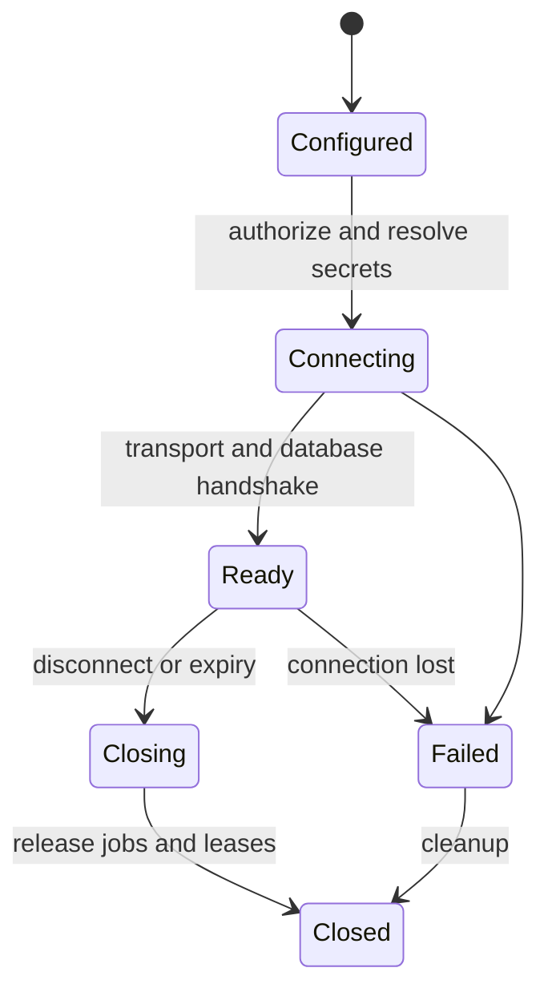

# Connection management

**Status: partially implemented evaluation.** Profile/group UI defaults to mocks, with explicit desktop Direct MySQL/MariaDB/PostgreSQL and SQLite-file read-only profiles. The [M003 runtime](../development/connection-lifecycle.md) has owner-scoped pools, TLS, expiry and shutdown tests; [M004](../development/postgres-sqlite.md) adds PostgreSQL VerifyFull TLS and owner-scoped SQLite file grants. Native live binding and renderer-bootstrap cleanup are implemented; credential storage and tunnels remain unimplemented.

## Identity and ownership

Separate non-secret profile metadata (name, engine, group, color, environment) from transport configuration and secret references. A runtime connection handle belongs to one desktop session or authenticated server principal. Database/schema, credentials, endpoint and generation are part of its identity. Never reuse a pool across unrelated principals merely because hosts match.

Proposed lifecycle:

Start transport before pool creation, enforce timeouts, and unwind in reverse order on failure. Use bounded pools, idle expiry and explicit disconnect. Transactions lease a physical connection; session variables, temporary objects and raw transaction statements can make a connection unsafe to return to the pool. Reset verifiably or discard it. Lost connections invalidate schema generations and active leases.

## Implementation sequence

M003-L accepts the Direct connection ownership, pool bounds, verified TLS and failure/expiry/disconnect cleanup independently of SQL/UI completion. M005 desktop credentials/SSH can start from that checkpoint without waiting for PostgreSQL/SQLite (M004), Axum or a server vault. Transport setup cancellation/cleanup is distinct from M006 execution cancellation, job/transaction leases and full schema metadata caching. PostgreSQL-over-SSH parity follows the adapter; SQLite does not gain a network transport by implication.

## Transports

Direct and SSH are first-stage proposals. Validate TLS certificates and SSH host keys; do not introduce trust-all fallbacks. SSH agent, key and password flows need OS-specific tests, passphrase secrecy, cancellation and tunnel lifetime ownership. Preserve the original database hostname for certificate verification through a local forwarded endpoint. SQLite path authorization is host-specific and has no SSH option by default.

Teleport (`tsh`) and AWS SSM are deferred. Their CLI processes, expiry, identity renewal and endpoint cleanup need separate threat/design reviews; do not shell-interpolate user input or assume they are drop-in SSH equivalents.

## Cache and failures

Autocomplete/schema caches are keyed by principal, connection generation, database and schema. Store metadata revisions, explicit refresh and TTL bounds; invalidate after DDL, reconnect or privilege change. Coalesce concurrent requests and discard stale replies after workspace switches. Keep credentials out of cache keys and diagnostics.

Test timeout, partial handshake, rejected host key, expired credentials, rapid workspace switches, cancelled connection attempts and cleanup under process shutdown. Production-tag UI confirmations remain UX safeguards, not server authorization.
