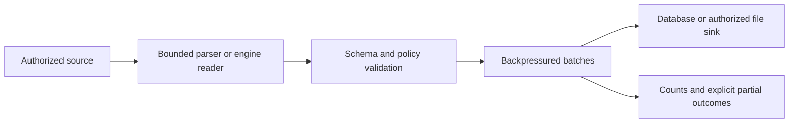

# Streaming import and export

**Status: Proposed / awaiting approval.** Current jobs simulate progress and summaries only; no real dump or compression is performed.

## Pipeline

Keep format configuration independent of Vue. Engine adapters supply quoting, object definitions and snapshot capabilities; transfer services own streaming, quotas and progress. Use cancellable bounded buffers; do not collect a whole database, CSV or workbook in memory.

## Format decisions

| Format | Proposed behavior / risks |
| --- | --- |
| SQL | Engine-aware DDL/data output; native dump tool versus logical exporter requires evaluation; import may partially commit DDL |
| CSV | Explicit encoding, delimiter, quoting, header, NULL and empty-string semantics; schema validation before writes |
| JSON | Tagged lossless values or documented plain export policy; streaming array/record framing |
| XLSX | Planned only; preserve text precision, reject formula execution, bound workbook expansion and rows |
| GZIP | Streaming compression with cancellation and byte quotas |
| ZIP | Bound expanded size/entries; evaluate streaming writer versus quota-limited temporary storage and central-directory requirements |

Compression is orthogonal to format. Structure-only is invalid for CSV and other formats without schema representation. No filename extension should imply a different format silently. Unsafe spreadsheet formula interpretation must be addressed without silently changing raw database values: use explicit safe-cell encoding/export options.

## Jobs, files and recovery

Desktop uses a native file permission/dialog grant, not unrestricted renderer paths. Server uses scoped uploads/download tokens, randomized temporary names, canonicalized paths and owner checks. Reject path traversal, symlinks where unsafe, archive bombs and over-quota jobs. Clean temporary files on cancellation, timeout, completion and restart; bounded job history contains no secrets or raw record content by default.

Expose read/written counts, skipped/rejected rows, snapshot consistency and committed/partial/unknown outcomes. SQL scripts and nontransactional engines cannot promise whole-file rollback. Resume/checkpoint support is deferred until requirements justify durable storage. Cancellation must stop future work and report already committed effects accurately.

## Approval and testing

Choose Rust CSV/JSON/XLSX/archive libraries after memory, license, Unicode, compression and malformed-input spikes. Test large streams under a measured memory budget, slow consumers, cancellation, disk full, truncated input, invalid encoding, precision, duplicate/FK failures and restart cleanup. Round-trip tests must use disposable engines and independently verify exported content. Simulation success is never backup verification.
