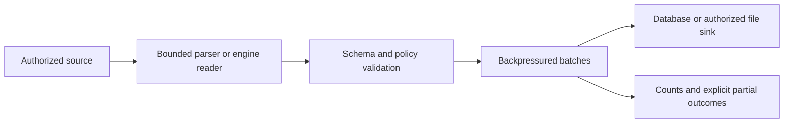

# Streaming import and export

**Status: partially implemented; the rest is Proposed / awaiting approval.** The desktop app implements live export (table, chosen tables or whole database; SQL, CSV and JSON; optional GZIP; one read-only snapshot; temporary file renamed when complete), CSV import into a table and MySQL/MariaDB SQL import; see the [user guide](../user-guide/import-export.md) for current behavior. Browser-demo jobs still simulate progress and summaries only. Limits and mechanisms not described in the user guide remain proposals.

## v0.1.0 Alpha scope

Basic **SQL and CSV import/export for MySQL/MariaDB** is part of the approved alpha feature scope (D022, 2026-10-26). The table below records that scope decision; for what is implemented, see the status above. Unimplemented mechanisms and limits remain **Proposed**.

| Format / feature | Alpha treatment |
| --- | --- |
| CSV export (table or query result) | Required; streaming, explicit encoding/delimiter/quote/header and a NULL marker distinct from the empty string |
| SQL export | Required; logical exporter (table structure plus batched inserts), no dependency on a native dump tool; InnoDB exported from a consistent read-only snapshot, non-transactional tables labelled as not snapshot-consistent; views, routines, triggers and events listed as omitted |
| CSV import into an existing table | Required; validated against live metadata, parameterized batches inside an owned transaction, stop on first error, truthful committed/rejected/unknown counts |
| SQL import | Required; statements run one at a time through the safe execution path, no whole-file rollback promise, implicit DDL commits stated; waits for the gate that enables unrestricted read-write SQL |
| GZIP | Proposed: export kept (no expansion risk; GZIP export is implemented); import deferred unless quotas apply to decompressed bytes with a tested expansion-ratio cap |
| XLSX import | **Deferred** (approved deferral) |
| XLSX and JSON export, ZIP | Proposed deferral; JSON export has since been implemented in the desktop app |
| PostgreSQL and SQLite transfers | Deferred with those engines' alpha status |

Files are reached only through native save/open dialogs that issue owner-scoped, one-shot grants; exports write to a temporary file beside the target and rename atomically, removing it on cancel or failure. File, record, batch and disk quotas are proposed for approval and are not yet set.

## Pipeline

Keep format configuration independent of Vue. Engine adapters supply quoting, object definitions and snapshot capabilities; transfer services own streaming, quotas and progress. Use cancellable bounded buffers; do not collect a whole database, CSV or workbook in memory.

## Format decisions

| Format | Proposed behavior / risks |
| --- | --- |
| SQL | Engine-aware DDL/data output; native dump tool versus logical exporter requires evaluation; import may partially commit DDL |
| CSV | Explicit encoding, delimiter, quoting, header, NULL and empty-string semantics; schema validation before writes |
| JSON | Tagged lossless values or documented plain export policy; streaming array/record framing |
| XLSX | Planned only, Deferred for the alpha; preserve text precision, reject formula execution, bound workbook expansion and rows |
| GZIP | Streaming compression with cancellation and byte quotas |
| ZIP | Bound expanded size/entries; evaluate streaming writer versus quota-limited temporary storage and central-directory requirements |

Compression is orthogonal to format. Structure-only is invalid for CSV and other formats without schema representation. No filename extension should imply a different format silently. Unsafe spreadsheet formula interpretation must be addressed without silently changing raw database values: use explicit safe-cell encoding/export options.

## Jobs, files and recovery

Desktop uses a native file permission/dialog grant, not unrestricted renderer paths. Server uses scoped uploads/download tokens, randomized temporary names, canonicalized paths and owner checks. Reject path traversal, symlinks where unsafe, archive bombs and over-quota jobs. Clean temporary files on cancellation, timeout, completion and restart; bounded job history contains no secrets or raw record content by default.

Expose read/written counts, skipped/rejected rows, snapshot consistency and committed/partial/unknown outcomes. SQL scripts and nontransactional engines cannot promise whole-file rollback. Resume/checkpoint support is deferred until requirements justify durable storage. Cancellation must stop future work and report already committed effects accurately.

## Approval and testing

Choose Rust CSV/JSON/XLSX/archive libraries after memory, license, Unicode, compression and malformed-input spikes. Test large streams under a measured memory budget, slow consumers, cancellation, disk full, truncated input, invalid encoding, precision, duplicate/FK failures and restart cleanup. Round-trip tests must use disposable engines and independently verify exported content. Simulation success is never backup verification.
