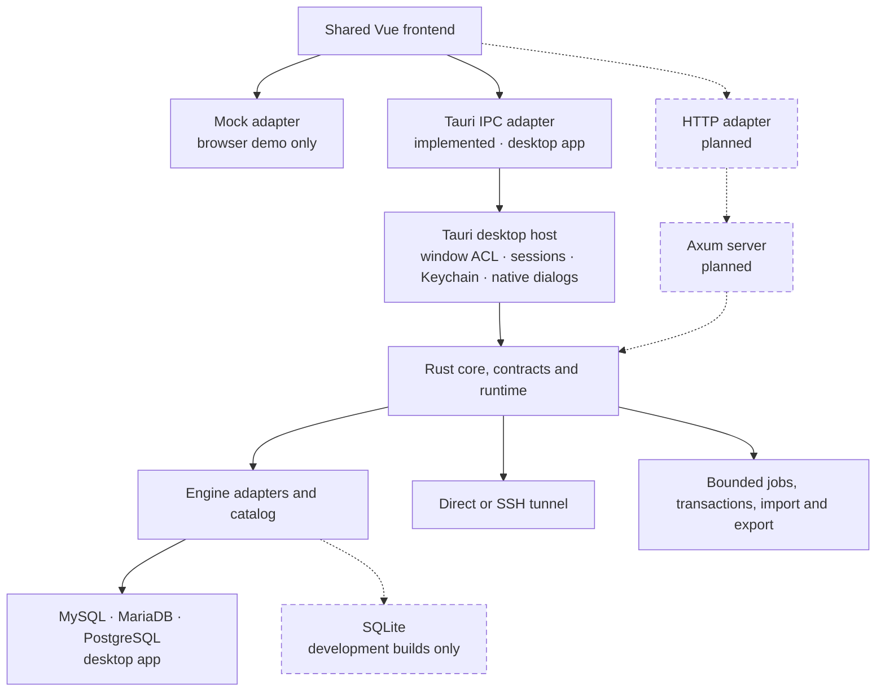

# Architecture overview

**Status: production architecture remains proposed.** M001 foundation is committed; the M002 Tauri development host is verified on macOS, with cross-OS/security gates open. M003 adds native Direct MySQL/MariaDB live profiles (read-only at first); M004 adds Direct PostgreSQL and natively granted SQLite files, M005 adds desktop SSH tunnels and macOS Keychain secret references, M006 adds read-write SQL execution and live CRUD, and M007 adds live import/export; acceptance gates remain open. The desktop app, published as the public beta v0.1.0-beta.1 (2026-11-17), is live-only; the browser build keeps the Vue mocks as a demo. Axum and the server remain unimplemented.

## Current system

Vue components call Pinia state, which uses session-only mock services in the browser demo and the native bridge (`services/nativeHost.ts`, `services/liveConnections.ts`) in the desktop app. Connection dialog test/save/connect/close/remove orchestration for mock and live profiles lives in `composables/useConnectionWorkflow.ts`, not in `App.vue`. Pure schema validation, engine capabilities and export configuration are separate from UI components. Non-secret profile/preferences persistence is browser-local. See [object coverage](../database-objects.md) and [SQL completion status](../development/browser-demo.md#sql-completion-status) for verified boundaries.

## Components

Solid boxes are implemented in the published desktop beta (v0.1.0-beta.1); dashed boxes are planned.

Desktop architecture remains cross-platform (macOS, Windows, Linux); v0.1.0-beta.1 shipped for macOS on Apple Silicon only; v0.1.0-beta.2 adds betas for Intel Macs, Windows x64 (without SSH tunnels) and Linux x86_64 — see the [roadmap](./roadmap.md). It is a live MySQL, MariaDB and PostgreSQL client: browsing, CRUD, SQL execution, structure editing, SSH and SQL/CSV/JSON import/export; SQLite, advanced objects and XLSX import are deferred. OS-specific code (such as the Keychain, DPAPI and Secret Service providers) stays in the desktop host or, for DPAPI's FFI, the Windows-only `stoneql-dpapi` crate; the shared Rust core does not depend on macOS host APIs. A later standalone Axum binary serves the same built frontend on Linux. The shared core owns connection/job lifecycles, typed values, capabilities, errors and validation; it imports neither Tauri nor Axum. Host adapters authenticate/authorize and translate versioned DTOs, without duplicating domain rules.

## Decisions and alternatives

| Concern | Proposed baseline | Alternative / approval gate |
| --- | --- | --- |
| Hosting | Desktop first; one server process later | Distributed services only with measured need |
| Drivers | SQLx receive-limit patch adopted for tested M003 MySQL/MariaDB subset; other capabilities remain gated | Native-driver exceptions require a recorded capability gap and approval |
| Contracts | Rust-owned versioned wire DTOs with generated TypeScript; IPC/HTTP bindings | Generator, runtime validation and framing require approval/spikes |
| Persistence | OS credential references; separate non-secret profiles | Server vault/key management needs threat review |
| Jobs | In-process bounded queues | Durable resumable queue is a separate requirement |

`crates/` contains shared core/contracts and the host-independent runtime evaluation. `apps/desktop/src-tauri/` contains the development host; `apps/server/` remains reserved. Split crates when ownership and compile dependencies justify it, rather than creating one crate per type. M001 should keep the domain/application core and wire-contract generation independent of both host frameworks; generated frontend contracts cannot introduce a Tauri dependency. Database adapters and connection transports remain separate extension boundaries. M001 introduced core/contracts and the driver lab; subsequent increments add the [desktop host](../development/desktop-host.md) and scoped [connection runtime](../development/connection-lifecycle.md). See [driver evaluation](./driver-evaluation.md) for the historical M001 evidence.

## Failure boundaries and risks

Network loss does not establish whether a mutation committed. Cancellation is best-effort. Typed errors must distinguish rejected, rolled-back, committed and unknown outcomes. Do not automatically retry arbitrary SQL. Bound memory, open connections and queued jobs per principal. The alpha budgets and the verified matrix (macOS arm64; MySQL 8.4.6, MariaDB 11.4.8, PostgreSQL 17.6) were approved on 2026-11-17 (A3); other server versions are outside that verified matrix.

[Roadmap](./roadmap.md) defines review gates, including M003 basic read-only SQL, the M003-L checkpoint unblocking SSH, M006 advanced execution, and independent M009 Desktop/M011 Server release paths. Security, integrity and compatibility are milestone acceptance criteria, not deferred hardening work. [API contracts](./api-contract.md), [integrity](./data-integrity.md) and [security](./security.md) describe shared responsibilities. [Tauri's security model](https://v2.tauri.app/security/) informs the IPC trust boundary; the development host implements a limited local-window ACL/CSP boundary, not production database or server authorization.
