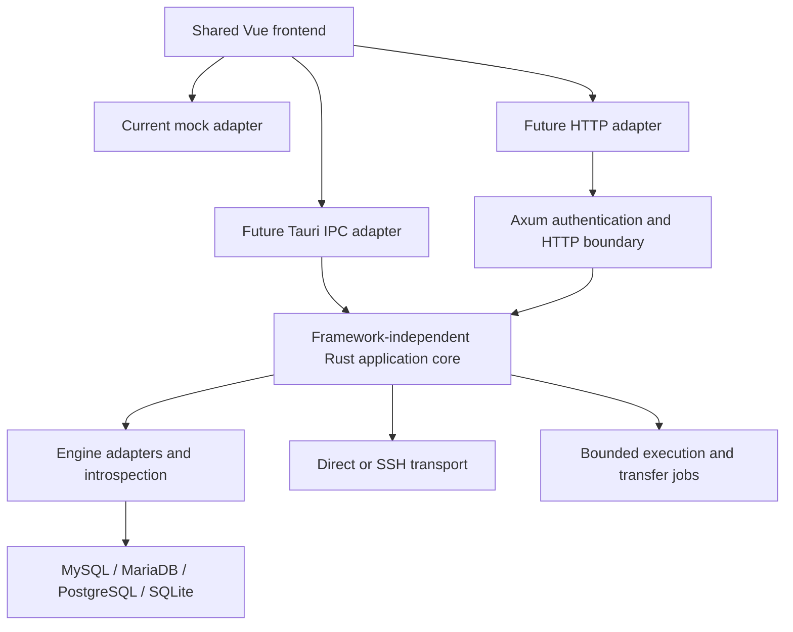

# Architecture overview

**Status: Proposed / awaiting human approval.** No Rust, Tauri, Axum or real connectivity is implemented. The Vue prototype remains the product baseline.

## Current system

Vue components call Pinia state and session-only mock services. Pure schema validation, engine capabilities and export configuration are separate from UI components. Non-secret profile/preferences persistence is browser-local. See [object coverage](../database-objects.md) and [SQL completion status](../user-guide/sql-editor.md) for verified boundaries.

## Proposed components

Desktop targets macOS, Windows and Linux. A later standalone Axum binary serves the same built frontend on Linux. The shared core owns connection/job lifecycles, typed values, capabilities, errors and validation; it imports neither Tauri nor Axum. Host adapters authenticate/authorize and translate versioned DTOs, without duplicating domain rules.

## Decisions and alternatives

| Concern | Proposed baseline | Alternative / approval gate |
| --- | --- | --- |
| Hosting | Desktop first; one server process later | Distributed services only with measured need |
| Drivers | Evaluate SQLx and engine-native drivers | Choose after dynamic-type/cancellation spikes |
| Contracts | Shared DTO semantics; IPC and HTTP bindings | Wire framing and compatibility policy require approval |
| Persistence | OS credential references; separate non-secret profiles | Server vault/key management needs threat review |
| Jobs | In-process bounded queues | Durable resumable queue is a separate requirement |

Potential future paths are `crates/` for focused shared libraries, `apps/desktop/` for Tauri and `apps/server/` for Axum. They are reserved names, not scaffolded applications. Split crates when ownership and compile dependencies justify it, rather than creating one crate per type.

## Failure boundaries and risks

Network loss does not establish whether a mutation committed. Cancellation is best-effort. Typed errors must distinguish rejected, rolled-back, committed and unknown outcomes. Do not automatically retry arbitrary SQL. Bound memory, open connections and queued jobs per principal. No performance targets or supported server versions have been approved yet.

[Roadmap](./roadmap.md) defines review gates. [API contracts](./api-contract.md), [integrity](./data-integrity.md) and [security](./security.md) describe shared responsibilities. [Tauri's security model](https://v2.tauri.app/security/) informs the IPC trust boundary; applying it to dbAdmin is a proposal, not a claim of existing protection.
