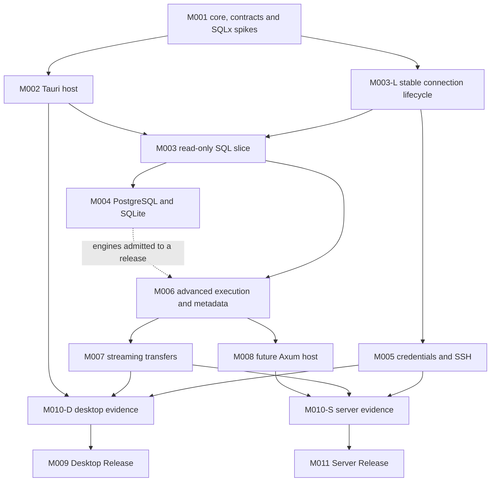
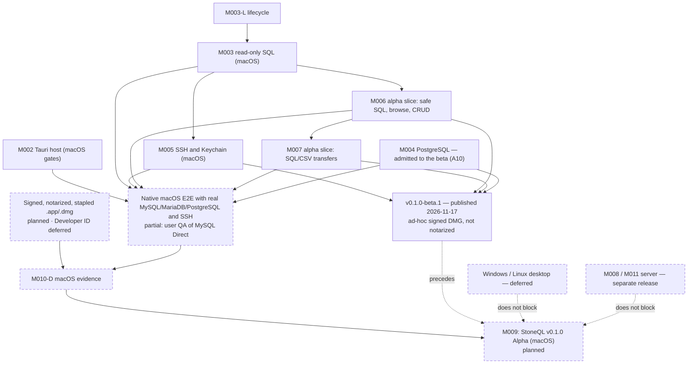

# Roadmap

**Status: revised roadmap and continuation through milestones authorized on 2026-10-25.** M001 is committed. M002's macOS development host is implemented, with Linux dependency-audit and cross-OS gates open. M003 lifecycle/read-only evaluation passes local fixtures; the user approved the scoped SQLx receive-limit patch. Explicit native live SQL binding is implemented; full native GUI interaction and broader driver/OS/release acceptance remain open. M004 PostgreSQL/SQLite read-only adapters are implemented locally with owned-fixture evidence; cross-OS, native picker/GUI and budget gates remain open. M005 desktop SSH tunnels and OS secret references are implemented locally (macOS) with owned-fixture evidence; cross-OS keychain/agent, GUI, transport-budget and decision-review gates remain open. Other milestones are pending, not completed by this authorization. Signing, publishing and deployment remain separate decisions.

**Published (2026-11-17):** the public beta **v0.1.0-beta.1** (tag → `970ade2`) is a GitHub [pre-release](https://github.com/stoneAce/stoneql/releases/tag/v0.1.0-beta.1): an ad-hoc signed, not notarized DMG for macOS arm64 with MySQL, MariaDB and PostgreSQL (Direct and SSH). The user approved the outstanding release decisions and signed off QA of `970ade2` on 2026-11-17; Developer ID signing and notarization are deferred. M002–M007 and M009 remain **open** with recorded engineering gaps; the beta does not complete them. Later sections keep the original v0.1.0 Alpha plan and its labels.

**v0.1.0-beta.2 (pre-release; decisions approved by the user 2026-11-17):** one release commit merging the Windows and Linux work, with macOS arm64 and x86_64 DMGs (ad-hoc signed, not notarized), an unsigned Windows x64 NSIS installer and an unsigned Linux x86_64 `.deb` (Ubuntu 22.04+, Debian 12+). Windows: Direct connections, read-write (outcome-journal port with accepted gaps) and DPAPI saved passwords; SSH tunnels are not available (endpoint design **Proposed / awaiting approval**) and renderer-crash recovery is not implemented. Linux: Direct and SSH, read-write, Secret Service or master-password file, renderer-crash recovery. Verification is limited: Windows on GitHub Server 2025 runners only, Linux on a headless build server and in containers, macOS x86_64 not run on Intel hardware ([status](../development/verification.md#platform-verification-status-v0-1-0-beta-2)). D021 below scoped the *alpha* to macOS; shipping Windows and Linux betas does not complete M002, M005 or M009 for those platforms.

**Approved product decision (2026-10-26, D021):** the first release is **StoneQL v0.1.0 Alpha for macOS only**. Apple Silicon (arm64) is the primary target; Intel (x86_64) is optional pending verification; Windows and Linux desktop are deferred; the Axum server is a separate future release. See [v0.1.0 Alpha (macOS)](#v0-1-0-alpha-macos) below. The ad-hoc beta above was published under this scope; the signed and notarized release work is not complete.

**Approved product decision (2026-10-26, D022):** the alpha is a **usable MySQL/MariaDB client** on macOS Apple Silicon — live browsing, CRUD, safe SQL execution, SSH and basic SQL/CSV import/export. PostgreSQL is optional for the first alpha; Windows, Linux, SQLite, advanced database objects and XLSX import are deferred. Deferred is not removed: implemented PostgreSQL/SQLite code and tests stay, outside alpha support claims unless admitted.

## Milestones and dependencies

Existing IDs and specification paths are retained. M009 now covers Desktop Release only; M011 adds Server Release. M010 supplies independently verifiable desktop/server evidence, not a shared completion barrier.

| Milestone | Scope | Required dependency / gate |
| --- | --- | --- |
| M000 | Monorepo, website and architecture audit | Existing prototype preserved; 17 browser scenarios passed with approved elevation; live docs/Mermaid checks remain separate |
| M001 | Core/contracts and isolated SQLx evaluation implemented; completion review pending | Startup approved; [executed evidence and limitations](./driver-evaluation.md) |
| M002 | Secure Tauri host integration | M001 contracts; native capability review; browser mode stays independent. For v0.1.0 Alpha only macOS native gates block; Windows/Linux native runs are **Deferred** |
| M003 | MySQL/MariaDB direct lifecycle plus basic read-only SQL | M001; M002 for the desktop UI binding; approved engine/TLS/limits profile |
| M004 | PostgreSQL and SQLite adapters | M003 connection pattern; engine-specific security/type/file gates; can run alongside M005. For v0.1.0 Alpha: PostgreSQL **optional** (admitted only if its alpha gates pass), SQLite **Deferred** (code kept, not claimed) — D022 |
| M005 | Desktop credentials and SSH | Verified **M003-L lifecycle checkpoint**, D005 desktop and D006 trust policy; no M004/Axum/server-vault prerequisite |
| M006 | Advanced SQL jobs, transactions, cancellation, object management and schema metadata/cache | M003 (M004 only for engines admitted to a release); D003/D004 and engine-specific capability evidence; M005 only for SSH integration tests. Alpha slice (D022): safe SQL execution, database/table tree, paged browse, single-row CRUD for MySQL/MariaDB; advanced objects **Deferred** |
| M007 | Streaming SQL/CSV/JSON/XLSX, ZIP/GZIP | M006; approved file/secret/format/snapshot limits; M005 only for SSH/desktop-credential integration. Alpha slice (D022): SQL and CSV import/export for MySQL/MariaDB; XLSX import **Deferred**; JSON/XLSX export, ZIP and GZIP import proposed deferred |
| M008 | Future authenticated Axum host and HTTP adapter | M001/M006; server-specific identity, vault, target-policy and quota approval |
| M009 | **Desktop Release**: first release is v0.1.0 Alpha, signed and notarized macOS arm64 (x86_64 optional); Windows/Linux packages **Deferred** to later desktop releases | M002, M003 and M005 macOS acceptance; the D022 alpha slices of M006 and M007; M004 PostgreSQL only if admitted; **M010-D (macOS)** evidence; no M008/M011 or M010-S dependency |
| M010 | Continuous hardening and release evidence | Incremental from M001; M010-D uses desktop implementation (macOS-only evidence set for the alpha), M010-S uses server implementation; neither requires a completed release |
| M011 | **Server Release**: Linux binary/systemd, optional Docker | M008 plus applicable M005–M007 capabilities and **M010-S** evidence; independent of M009 distribution |

M003-L is a checkpoint inside M003, not a new milestone: verified connect/failure/disconnect/expiry cleanup, isolated bounded pools, TLS verification, redacted errors and repeated lifecycle tests. It can be accepted before M003's SQL/UI work and unlocks M005 without waiting for M002 UI binding or M004 adapters. Basic timeouts and cleanup belong to this lifecycle; execution cancellation and transaction APIs belong to M006.

The diagram shows sequencing, not a requirement to implement every future capability for the first release. Any reduced engine/feature release scope needs explicit approval, capability gating and documented omissions; it cannot silently waive acceptance criteria. D022 is that approval for v0.1.0 Alpha. Teleport and AWS SSM remain transport extension points and later investigations. Axum remains a future adapter; do not build it to unblock desktop work.

## v0.1.0 Alpha (macOS)

Statements in this section carry one label: **Approved product decision**, **Implemented and verified** (executed locally, evidence recorded), **Proposed technical decision** (awaiting approval), **Deferred** (not required for v0.1.0 Alpha, open for later releases) or **Unresolved release blocker**.

### Platform scope

| Item | Label |
| --- | --- |
| macOS Apple Silicon (arm64) is the primary v0.1.0 Alpha target | Approved product decision (D021, 2026-10-26) |
| macOS Intel (x86_64) ships only if separately verified; otherwise the alpha is arm64-only | Approved product decision; the inclusion decision itself is unresolved |
| Windows desktop, Linux desktop | Deferred; their implementation and testing must not block the alpha |
| Axum server (M008/M011) | Deferred to a separate future release; unchanged independent track |
| Cross-platform architecture: shared Rust crates stay host- and OS-independent; macOS-only code stays in the desktop host behind target gates (as `security-framework` is today) | Approved product decision; current boundary checks are Implemented and verified locally |

### Required for the alpha

The approved decision lists nine release requirements. Their current state:

| Requirement | Current state | Label |
| --- | --- | --- |
| Native Tauri packaging (.app, distributable image) | `bundle.active` is `false` in the base config; `desktop:bundle:adhoc` builds the ad-hoc signed `.app` and DMG published as v0.1.0-beta.1 (2026-11-17) with a SHA-256 file and SBOMs; minimum macOS version not set explicitly (Info.plist default 10.13; verified on 27.0.1 only) | Implemented for the ad-hoc beta; Developer ID-signed packaging remains an Unresolved release blocker |
| macOS Keychain integration | Login-Keychain secret references through actual command handlers (MockRuntime) with fixture cleanup | Implemented and verified on fixtures; ships in the beta. On the ad-hoc beta a new build prompts twice for an item saved by an earlier build ([user steps](../guide/troubleshooting.md#keychain-prompts)); behavior after Developer ID signing is an Unresolved release blocker |
| SSH authentication and tunnel reliability | Agent/password/key-file tunnels, enrolled host keys, 100 mixed cycles with zero orphans on macOS ARM fixtures | Implemented and verified (fixtures); graphical end-to-end and approved transport budget are Unresolved release blockers |
| Real MySQL/MariaDB workflows | Bounded read-only SQL against MySQL 8.4.6 / MariaDB 11.4.8 fixtures through command handlers; live browsing, CRUD, read-write SQL and transfers implemented locally (see feature scope below) | Implemented and verified (fixtures) for read-only SQL; the other workflows are implemented but not accepted and remain Unresolved release blockers |
| Application signing and notarization | Ad-hoc signature only; no Developer ID identity, entitlements or notarization configured | Unresolved release blocker; credentials need human approval |
| Install/upgrade/uninstall behavior | Executed on the ad-hoc beta DMG (2026-11-17): drag-to-Applications install, upgrade over the previous build keeping profiles and saved-password references, uninstall/reinstall keeping data; [user steps](../guide/install.md#update-to-a-newer-build). No data-migration policy | Executed for the ad-hoc beta; signed-build drills and policy remain Unresolved release blockers |
| Native end-to-end testing | User QA of the packaged `970ade2` app against MySQL over Direct (signed off 2026-11-17); other engines and SSH only through MockRuntime handlers, browser shims and WebView smokes | Partially executed; MariaDB, PostgreSQL and SSH in the packaged app remain Unresolved release blockers |
| Resource usage and startup performance | Beta DMG (2026-11-17): 30 cold launches, median 1.82 s, p95 2.79 s; idle whole-app RSS 191 MiB; budgets approved 2026-11-17 (A3). No 8-connection whole-app RSS yet | Partially executed; 8-connection RSS remains open |
| Secure credential cleanup and session lifecycle | Profile removal deletes its Keychain item and reports a failed deletion (**Remove anyway**); pools/tunnels close on disconnect/reset/shutdown; no purge-all, and uninstall leaves Keychain items (documented) | Partially implemented; purge-all and sleep/wake/network-change orphan checks remain open |

### Feature scope (D022)

| Capability | Alpha treatment | Current state |
| --- | --- | --- |
| Live browsing: database/table tree, paged browse with server-side sort and filter | Approved product decision (required) | Shipped in v0.1.0-beta.1 for MySQL/MariaDB/PostgreSQL (MySQL/MariaDB: every visible database with switching and Create database; PostgreSQL: current database and schema; server-side paging, sort, filter, exact count); milestone not accepted |
| CRUD: single-row insert/update/delete with primary-key-based optimistic checks and authoritative constraint errors; tables without a primary key browse-only | Approved (required); slice details are Proposed | Shipped in v0.1.0-beta.1 for tables with a primary key on read-write connections, statements fixture-verified (`test:execution`); milestone not accepted |
| Safe SQL execution: background jobs, `BUSY` instead of queuing, best-effort cancellation, no automatic retry of uncertain writes, outcomes reported as confirmed success, failure, cancellation or unknown, owned and expiring transactions | Approved principles; numeric limits and contract details Proposed | Read-only SQL implemented and verified; execution jobs, transactions and writes implemented with fixture evidence, not accepted. Read-write is enabled since A15 (2026-11-17) for MySQL/MariaDB over Direct and SSH and PostgreSQL over Direct; PostgreSQL over SSH stays read-only ([details](../development/sql-execution.md)) |
| SSH and saved credentials | Approved (required); native host-key trust ownership approved; four review findings plus secret-deletion error handling are alpha blockers | Implemented and verified on fixtures; ships in the beta. The four review findings and secret-deletion reporting are fixed; open: native trust dialog in a real window, the approved RSA/keyboard-interactive policy (A12) and an SSH run of the packaged app |
| SQL and CSV import/export (MySQL/MariaDB) | Approved (required); GZIP export proposed, GZIP import proposed deferred | Shipped in v0.1.0-beta.1: export (SQL/CSV/JSON, optional GZIP) and CSV and MySQL/MariaDB SQL import; milestone not accepted |
| PostgreSQL | Optional; admitted only if its alpha gates pass | Admitted to the beta (A10, 2026-11-17): Browse, read-write over Direct (read-only over SSH), column/index changes and data-only export ship in v0.1.0-beta.1; no graphical run in the packaged app; milestone not accepted |
| SQLite | **Deferred** (code kept, outside support claims) | Read-only adapter implemented and verified on fixtures |
| Advanced objects (routines, triggers, events, materialized views, object DDL editing), XLSX import | **Deferred** | Mock screens only |
| Windows, Linux | **Deferred** for the alpha | Shipped as betas in v0.1.0-beta.2 (Windows without SSH tunnels); real-hardware and real-desktop checks pending |

Anything excluded must be capability-gated and listed as an omission; acceptance criteria are not waived silently.

### Alpha dependency view

Dashed boxes are not done yet; the published beta is shown separately.

Deferred items keep their open gates for later releases: SQLite live support, advanced database objects, XLSX import, Linux GTK dependency advisories (now two documented exceptions in the Linux release audit, approved 2026-11-17), Windows SSH endpoint and agent, Windows SQLite path handling, and real-hardware Windows, Intel Mac and real-desktop Linux checks. Windows and Linux credential stores and Windows CI now exist (v0.1.0-beta.2). The internal decision register records them as deferred non-blockers for the alpha, never as passed; a deferred security advisory still needs an explicit human risk acceptance before sign-off.

## Initial slice and shared contracts

M003 executes a bounded, single read-only statement and displays typed columns/rows in the existing SQL workspace. Database privileges and engine read-only enforcement are required: a SELECT prefix or UI toggle is not a security boundary. No DML/DDL, routine execution, multi-statement scripts, user transactions, background query jobs or execution-cancel API is exposed. Per-result column metadata is necessary; full schema discovery, revisions, refresh and autocomplete caches remain M006. A deadline/connection close must not be described as confirmed server-side cancellation.

Shared Rust core/contracts stay independent of Tauri and Axum. Rust v1 wire DTOs are the source of truth for **generated** TypeScript, checked for drift in CI; handwritten parallel contracts are not the fallback. The generator and runtime validation strategy remain approval/spike decisions. See [API contract](./api-contract.md).

**SQLx remains the proposed driver**, subject to recorded spikes for dynamic types, lossless raw values, multiple result sets, stored procedures, cancellation, TLS and connection cleanup. Approve capabilities per engine and milestone; neither a documented API nor a SELECT demo proves the full driver suitable. Native-driver exceptions require evidence and a new decision, not a quiet replacement. See [adapters](./database-adapters.md).

## Gates applied throughout

Every relevant milestone must carry these gates and its own feature-specific tests. M010 aggregates evidence and adversarial testing; it does not defer baseline security, integrity or compatibility until the end.

| Gate | Required evidence |
| --- | --- |
| G1 Security | Negative boundary/ownership tests, verified TLS/SSH where applicable, secret-redacted logs/errors, dependency/license review; no unresolved critical/high findings without explicit owner risk acceptance |
| G2 Integrity | Exact BIGINT/DECIMAL/temporal and NULL/default fixtures; no silent coercion; atomicity/conflict/partial-outcome checks for applicable mutations |
| G3 Compatibility | Approved OS/architecture, engine/version and protocol matrix; generated DTO drift and unsupported-version tests; unsupported capabilities clearly rejected |
| G4 Performance | Reproducible reference workload, hardware, raw samples, p95 latency and peak memory/queue/file/connection counts; approved numerical limits, no unrecorded regressions |
| G5 Reliability | Timeout/disconnect/shutdown/failure injection; bounded cleanup, no cross-session leaks or automatic mutation retry; accurate partial/unknown outcomes |
| G6 Packaging | Per-track artifact checksums, install/upgrade/rollback/uninstall, applicable signing/notarization verification, SBOM/license and secret scans; restore/rollback drills |

### Release measurement profile

These are starting budgets, not existing product guarantees. On 2026-11-17 the user approved the desktop budgets and the M002–M005 matrix (A3); the server candidate row is still unapproved. Local M003 [runtime resource profiles](../development/resource-profiles.md) now measure a subset; they exclude native IPC/renderer overhead and do not satisfy the full release gates. M001 first records the exact reference OS/CPU (at least 4 cores), RAM (8 GiB), SSD, toolchain/engine versions and local disposable DB RTT (at most 5 ms). Cross-OS runners are separately recorded. No production credentials or databases are used.

| Measurement | Proposed threshold / reproducible workload | First owner |
| --- | --- | --- |
| Direct lifecycle | 100 connect/query/disconnect cycles per supported engine; 0 leaked handles after at most 5 s cleanup; TLS connect p95 at most 3 s | M003-L; repeat M004/M005 |
| Basic SQL | 100 indexed SELECTs, 200 rows of at most 1 KiB each from a 100,000-row fixture; request-to-final-bounded-response p95 at most 500 ms; peak additional RSS at most 64 MiB above connected idle | M003; repeat M004/M006 |
| Advanced execution | Accepted cancel request to terminal client state p95 at most 2 s; unconfirmed server termination reported explicitly; 100 fault/transaction cycles, 0 dirty connections returned to pools | M006 |
| Transfers | 1 million 1-KiB rows with a slow consumer; additional RSS at most 256 MiB; configured quotas never exceeded; temporary resources removed within 30 s after cancellation | M007 |
| Desktop candidate | v0.1.0 Alpha: 30 launches of the signed release artifact on macOS arm64 (and x86_64 if shipped); cold-launch-to-interactive p95 at most 3 s; idle and 8-connection RSS of the whole app (host + WebView processes) recorded; 100 lifecycle/upgrade smoke cycles, 0 crashes/data-loss incidents. Windows/Linux runs deferred to their releases | M009/M010-D |
| Server candidate | 10 principals, 2 concurrent queries each, 30-minute reference workload; no cross-principal access, quota breaches or process crashes; same bounded SELECT p95 at most 1 s | M008/M010-S/M011 |

Before implementation, approve or replace the relevant profile; before release, execute it on the declared matrix. First releases additionally require zero unsupported-protocol acceptance, zero silent value corruption and successful packaging/security checks for **every** shipped artifact. A missing target, fixture, owner or result blocks that scope's sign-off. No approved server uptime/SLO, RPO/RTO, installer-size or production throughput target exists; server availability and recovery objectives must be set before M011 rather than invented here. Baseline startup/reliability metrics are not HA guarantees.

## Approval gates

### Required before starting M001

1. Approve M001's limited foundation/spike scope and the independent core/host boundary; no Tauri/Axum application or production connection feature in M001.
2. Authorize SQLx as the **evaluation baseline**, the disposable MySQL/MariaDB fixture versions and bounded exploratory engine probes; final capability adoption follows evidence.
3. Confirm Rust-owned v1 DTOs and generated TypeScript. Recommendation: evaluate `ts-rs` first, verify serialization/NULL/big-number cases, and approve the generator before defining production DTOs; no dependency is installed in this planning task.
4. Approve the M001 toolchain/fixture/reference-runner matrix and initial lifecycle/basic-query measurement profile, or specify replacements. Later desktop/server release budgets are separate gates and cannot block M001. M001 may record capability gaps; it must not claim untested OS/engine support.

### Later, before the affected milestone

- M002/M003: native permissions, exact TLS/engine support and read-only enforcement policy.
- M005: desktop secret provider, host-key enrollment/rotation and agent policy; server vault approval is separate.
- M006/M007: job framing, transaction leases, cancellation/unknown outcomes, schema revisions, transfer libraries and snapshot/quota guarantees.
- M008/M011: authentication/authorization, server vault and target restrictions, deployment/recovery/SLO ownership.
- M009: desktop artifact formats, signing/update custody, offline behavior and M010-D sign-off; it must not wait for server design approval. For v0.1.0 Alpha (macOS) this means (feature scope already approved by D022): Apple Developer ID identity and notarization credential custody, bundle identifier (decided 2026-11-16: `me.thixpin.stoneql`, A14; freeze it at the first public alpha), minimum macOS version, x86_64 inclusion, distribution format, updater stance, App Sandbox yes/no and risk acceptance for deferred Linux-only advisories.

**Approval record:** the user explicitly approved the revised roadmap and M001 startup on 2026-10-25, including foundation, generated DTOs, pinned tooling/fixtures and isolated SQLx evaluation. That scope is implemented; review [results](./driver-evaluation.md) before completion sign-off. The subsequent instruction “commit and continue all ms” authorizes local milestone implementation and commits. M002 development integration and M003 evaluations have progressed as recorded above. Production driver adoption, unresolved security/release gates, signing, push/publication and deployment are not approved by inference.
