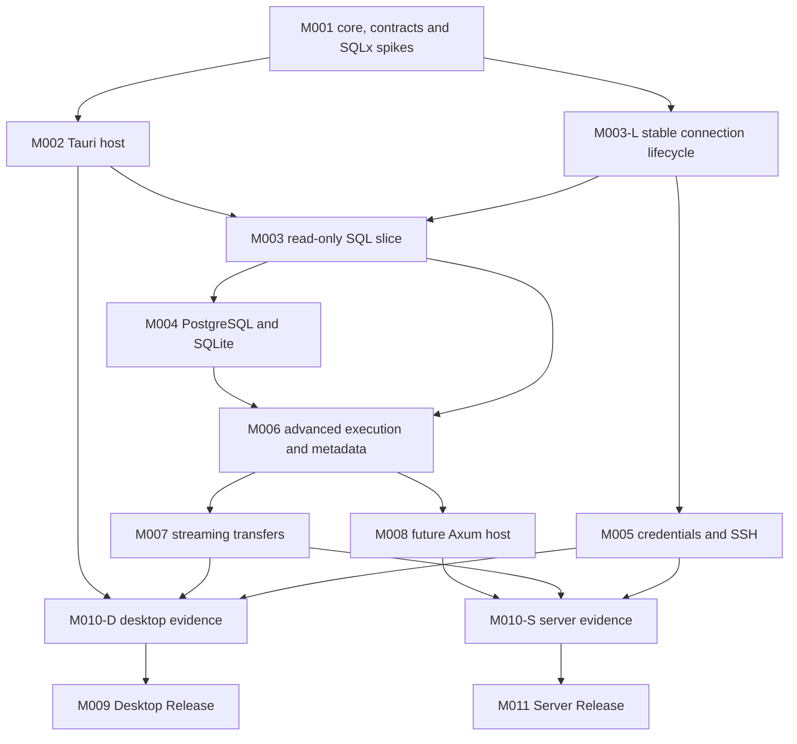

# Roadmap

**Status: revised roadmap and M001 startup explicitly approved on 2026-10-25.** M001 foundation/evaluation is implemented and awaits completion review. Production driver adoption, later milestone implementation and release/deployment decisions remain separate gates. M002 has not started.

## Milestones and dependencies

Existing IDs and specification paths are retained. M009 now covers Desktop Release only; M011 adds Server Release. M010 supplies independently verifiable desktop/server evidence, not a shared completion barrier.

| Milestone | Scope | Required dependency / gate |
| --- | --- | --- |
| M000 | Monorepo, website and architecture audit | Existing prototype preserved; 17 browser scenarios passed with approved elevation; live docs/Mermaid checks remain separate |
| M001 | Core/contracts and isolated SQLx evaluation implemented; completion review pending | Startup approved; [executed evidence and limitations](./driver-evaluation.md) |
| M002 | Secure Tauri host integration | M001 contracts; native capability review; browser mode stays independent |
| M003 | MySQL/MariaDB direct lifecycle plus basic read-only SQL | M001; M002 for the desktop UI binding; approved engine/TLS/limits profile |
| M004 | PostgreSQL and SQLite adapters | M003 connection pattern; engine-specific security/type/file gates; can run alongside M005 |
| M005 | Desktop credentials and SSH | Verified **M003-L lifecycle checkpoint**, D005 desktop and D006 trust policy; no M004/Axum/server-vault prerequisite |
| M006 | Advanced SQL jobs, transactions, cancellation, object management and schema metadata/cache | M003/M004; D003/D004 and engine-specific capability evidence; M005 only for SSH integration tests |
| M007 | Streaming SQL/CSV/JSON/XLSX, ZIP/GZIP | M006; approved file/secret/format/snapshot limits; M005 only for SSH/desktop-credential integration |
| M008 | Future authenticated Axum host and HTTP adapter | M001/M006; server-specific identity, vault, target-policy and quota approval |
| M009 | **Desktop Release**: signed macOS/Windows/Linux packages | M002–M007 for the declared desktop scope; **M010-D** release evidence; no M008/M011 or M010-S dependency |
| M010 | Continuous hardening and release evidence | Incremental from M001; M010-D uses desktop implementation, M010-S uses server implementation; neither requires a completed release |
| M011 | **Server Release**: Linux binary/systemd, optional Docker | M008 plus applicable M005–M007 capabilities and **M010-S** evidence; independent of M009 distribution |

M003-L is a checkpoint inside M003, not a new milestone: verified connect/failure/disconnect/expiry cleanup, isolated bounded pools, TLS verification, redacted errors and repeated lifecycle tests. It can be accepted before M003's SQL/UI work and unlocks M005 without waiting for M002 UI binding or M004 adapters. Basic timeouts and cleanup belong to this lifecycle; execution cancellation and transaction APIs belong to M006.

The diagram shows sequencing, not a requirement to implement every future capability for the first release. Any reduced engine/feature release scope needs explicit approval, capability gating and documented omissions; it cannot silently waive acceptance criteria. Teleport and AWS SSM remain transport extension points and later investigations. Axum remains a future adapter; do not build it to unblock desktop work.

## Initial slice and shared contracts

M003 executes a bounded, single read-only statement and displays typed columns/rows in the existing SQL workspace. Database privileges and engine read-only enforcement are required: a SELECT prefix or UI toggle is not a security boundary. No DML/DDL, routine execution, multi-statement scripts, user transactions, background query jobs or execution-cancel API is exposed. Per-result column metadata is necessary; full schema discovery, revisions, refresh and autocomplete caches remain M006. A deadline/connection close must not be described as confirmed server-side cancellation.

Shared Rust core/contracts stay independent of Tauri and Axum. Rust v1 wire DTOs are the source of truth for **generated** TypeScript, checked for drift in CI; handwritten parallel contracts are not the fallback. The generator and runtime validation strategy remain approval/spike decisions. See [API contract](./api-contract.md).

**SQLx remains the proposed driver**, subject to recorded spikes for dynamic types, lossless raw values, multiple result sets, stored procedures, cancellation, TLS and connection cleanup. Approve capabilities per engine and milestone; neither a documented API nor a SELECT demo proves the full driver suitable. Native-driver exceptions require evidence and a new decision, not a quiet replacement. See [adapters](./database-adapters.md).

## Gates applied throughout

Every relevant milestone must carry these gates and its own feature-specific tests. M010 aggregates evidence and adversarial testing; it does not defer baseline security, integrity or compatibility until the end.

| Gate | Required evidence |
| --- | --- |
| G1 Security | Negative boundary/ownership tests, verified TLS/SSH where applicable, secret-redacted logs/errors, dependency/license review; no unresolved critical/high findings without explicit owner risk acceptance |
| G2 Integrity | Exact BIGINT/DECIMAL/temporal and NULL/default fixtures; no silent coercion; atomicity/conflict/partial-outcome checks for applicable mutations |
| G3 Compatibility | Approved OS/architecture, engine/version and protocol matrix; generated DTO drift and unsupported-version tests; unsupported capabilities clearly rejected |
| G4 Performance | Reproducible reference workload, hardware, raw samples, p95 latency and peak memory/queue/file/connection counts; approved numerical limits, no unrecorded regressions |
| G5 Reliability | Timeout/disconnect/shutdown/failure injection; bounded cleanup, no cross-session leaks or automatic mutation retry; accurate partial/unknown outcomes |
| G6 Packaging | Per-track artifact checksums, install/upgrade/rollback/uninstall, applicable signing/notarization verification, SBOM/license and secret scans; restore/rollback drills |

### Proposed measurement profile — not approved or measured

These are reviewable starting budgets, not existing product guarantees. M001 first records the exact reference OS/CPU (at least 4 cores), RAM (8 GiB), SSD, toolchain/engine versions and local disposable DB RTT (at most 5 ms). Cross-OS runners are separately recorded. No production credentials or databases are used.

| Measurement | Proposed threshold / reproducible workload | First owner |
| --- | --- | --- |
| Direct lifecycle | 100 connect/query/disconnect cycles per supported engine; 0 leaked handles after at most 5 s cleanup; TLS connect p95 at most 3 s | M003-L; repeat M004/M005 |
| Basic SQL | 100 indexed SELECTs, 200 rows of at most 1 KiB each from a 100,000-row fixture; request-to-final-bounded-response p95 at most 500 ms; peak additional RSS at most 64 MiB above connected idle | M003; repeat M004/M006 |
| Advanced execution | Accepted cancel request to terminal client state p95 at most 2 s; unconfirmed server termination reported explicitly; 100 fault/transaction cycles, 0 dirty connections returned to pools | M006 |
| Transfers | 1 million 1-KiB rows with a slow consumer; additional RSS at most 256 MiB; configured quotas never exceeded; temporary resources removed within 30 s after cancellation | M007 |
| Desktop candidate | 30 launches per supported OS; cold-launch-to-interactive p95 at most 3 s; 100 lifecycle/upgrade smoke cycles, 0 crashes/data-loss incidents | M009/M010-D |
| Server candidate | 10 principals, 2 concurrent queries each, 30-minute reference workload; no cross-principal access, quota breaches or process crashes; same bounded SELECT p95 at most 1 s | M008/M010-S/M011 |

Before implementation, approve or replace the relevant profile; before release, execute it on the declared matrix. First releases additionally require zero unsupported-protocol acceptance, zero silent value corruption and successful packaging/security checks for **every** shipped artifact. A missing target, fixture, owner or result blocks that scope's sign-off. No approved server uptime/SLO, RPO/RTO, installer-size or production throughput target exists; server availability and recovery objectives must be set before M011 rather than invented here. Baseline startup/reliability metrics are not HA guarantees.

## Approval gates

### Required before starting M001

1. Approve M001's limited foundation/spike scope and the independent core/host boundary; no Tauri/Axum application or production connection feature in M001.
2. Authorize SQLx as the **evaluation baseline**, the disposable MySQL/MariaDB fixture versions and bounded exploratory engine probes; final capability adoption follows evidence.
3. Confirm Rust-owned v1 DTOs and generated TypeScript. Recommendation: evaluate `ts-rs` first, verify serialization/NULL/big-number cases, and approve the generator before defining production DTOs; no dependency is installed in this planning task.
4. Approve the M001 toolchain/fixture/reference-runner matrix and initial lifecycle/basic-query measurement profile, or specify replacements. Later desktop/server release budgets are separate gates and cannot block M001. M001 may record capability gaps; it must not claim untested OS/engine support.

### Later, before the affected milestone

- M002/M003: native permissions, exact TLS/engine support and read-only enforcement policy.
- M005: desktop secret provider, host-key enrollment/rotation and agent policy; server vault approval is separate.
- M006/M007: job framing, transaction leases, cancellation/unknown outcomes, schema revisions, transfer libraries and snapshot/quota guarantees.
- M008/M011: authentication/authorization, server vault and target restrictions, deployment/recovery/SLO ownership.
- M009: desktop artifact formats, signing/update custody, offline behavior and M010-D sign-off; it must not wait for server design approval.

**Approval record:** the user explicitly approved the revised roadmap and M001 startup on 2026-10-25, including foundation, generated DTOs, pinned tooling/fixtures and isolated SQLx evaluation. That scope is implemented; review [results](./driver-evaluation.md) before completion sign-off. Production SQLx adoption, later milestone starts and detailed release budgets remain unapproved. Stop at M001; do not begin M002 or commit/push without a new instruction.
